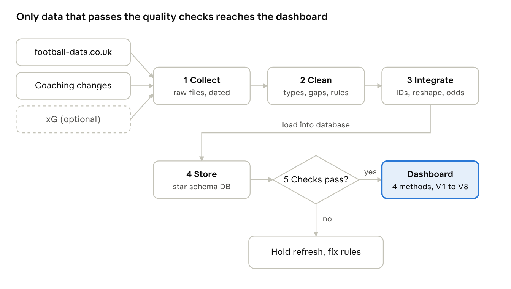
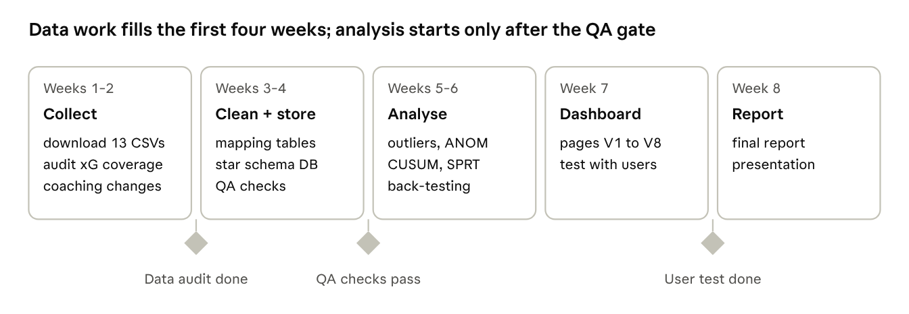

# Project Proposal — Topic 2

22 November 2026

## 1. Topic and problem statement

We will build a monitoring tool that tells football decision-makers whether a change in performance is real or just noise, using outlier detection, analysis of means (ANOM), CUSUM and the sequential probability ratio test (SPRT) on English Premier League (EPL) data.

**Assigned topic (Topic 2):** outlier detection, analysis of means, CUSUM and sequential probability ratio testing, applied to sports.

**The practical problem.** Football decisions are often made on short, noisy runs of results. Clubs sack managers after a few bad weeks, media blame referees after a single match, and analysts pick "crisis" matches by eye. A team can lose three games in a row by chance while still creating more chances than its opponents. Decision-makers need a signal that is early, quantified and resistant to luck.

**Project questions.** Each question maps to one method from the topic:

1. **Outlier detection:** Which team-matches are statistical outliers (shots, shots on target, fouls, cards, goals versus expectation) and deserve video review?
2. **ANOM:** Which referees give significantly more or fewer cards and fouls per match than the league average?
3. **CUSUM:** When did a team's underlying performance (shots-on-target difference per match) shift, and how many matches earlier than the league table would CUSUM have flagged it?
4. **SPRT:** After a manager change, how many matches are needed to decide whether the team has genuinely improved?

**Scope.** EPL, seasons 2014/15 to 2025/26 (12 seasons, 4,560 matches) for building and calibrating the methods. Matches played so far in 2026/27 are used as a live monitoring demonstration. Analysis is at team, referee and manager level; player-level form tracking is an optional extension.

## 2. Intended users and their needs

Three user groups face the same core need: to separate real change from random variation before acting on it.

| User | Need | Question they ask | Decision or task supported |
| --- | --- | --- | --- |
| Club sporting director / board | Judge the head coach on evidence, not on a short run of results | Has our underlying performance really declined, and since when? Has the new coach really improved the team? | Keep, warn or replace the head coach; set a review point after a coaching change |
| Club performance analyst | Spot form shifts early and pick matches worth reviewing | Which of our matches were abnormal, and when did our trend change? | Choose matches for video review; brief the coaching staff weekly |
| Referee committee / assessor | Check that referees apply the laws consistently | Which referees card or penalise fouls significantly more or less than the league average? | Select referees for calibration training or closer assessment |

A secondary audience is sports journalists and fans, who can use the same views to check claims of "crisis" or "biased referee" against the data.

## 3. Data sources and feasibility

The core of the project needs only two free sources, and both were downloaded and checked on 22 November 2026; expected goals (xG) are an optional extra.

**Required sources**

| Source | Content | Coverage (checked 22 Nov 2026) | Access | Used for |
| --- | --- | --- | --- | --- |
| [football-data.co.uk EPL files](https://www.football-data.co.uk/englandm.php) | One row per match: result, referee, shots, shots on target, fouls, corners, yellow and red cards, closing betting odds ([column notes](https://www.football-data.co.uk/notes.txt)) | All 13 season files downloaded: 380 matches in each season 2014/15 to 2025/26 (4,560 in total) and 100 matches so far in 2026/27. No missing values in referee, shots on target or yellow cards | Free CSV per season, `https://www.football-data.co.uk/mmz4281/<season>/E0.csv` (for example `2425`) | All four methods |
| Wikipedia season pages, "Managerial changes" table (for example [2025–26 Premier League](https://en.wikipedia.org/wiki/2025%E2%80%9326_Premier_League)) | Team, outgoing coach, manner of departure, date of vacancy, table position, incoming coach, date of appointment | Table present on every season page checked (2014–15, 2020–21, 2025–26, 2026–27), with 4 to 13 changes per season | Free web page, scraped once per season | SPRT (question 4) and coaching-change markers on CUSUM charts |

**Optional sources**

| Source | Content | Status (checked 22 Nov 2026) | Use if available |
| --- | --- | --- | --- |
| xG columns (HxG/AxG) in the football-data files | Team xG per match | Present only in 2026/27; absent in all 12 earlier seasons | Cross-check the 2026/27 live demonstration |
| [Understat](https://understat.com/league/EPL) via the [understat Python package](https://github.com/amosbastian/understat) | Team and player xG | Site offline ("We will come back soon") | Historical xG, if the site returns |

**Consequence for the analysis.** Historical xG is not available, so underlying performance is measured with shots-on-target difference, and opponent strength with expected points derived from closing betting odds. Odds give a pre-match expectation for every match, which makes "surprise" results and over/under-performance measurable without xG.

**Known quality issues to handle.**

- Closing odds change across seasons. Pinnacle closing odds (PSCH) exist for 2014/15 to 2025/26, but 170 of 380 values are blank in 2025/26 and the column is absent in 2026/27. Market-average closing odds (AvgCH) are complete from 2019/20. Plan: PSCH up to 2018/19, AvgCH from 2019/20, with the two compared on the overlapping seasons.
- Yellow cards in English files do not count the first yellow when a second yellow turns into a red ([notes](https://www.football-data.co.uk/notes.txt)); booking points will be checked as an alternative.
- Team names differ between sources: football-data uses short forms ("Man United", "Nott'm Forest", "Wolves"), Wikipedia uses full names ("Wolverhampton Wanderers").
- Referee names in football-data use initial and surname ("M Oliver"); they must map to one stable ID across seasons.
- Wikipedia tables contain merged cells, footnote markers (for example "[107]"), dates written as text ("8 September 2025") and pre-season changes with no match before them.
- CSV files start with a byte-order mark, and some contain blank trailing rows (one in 2014/15); both must be handled on load.
- 2019/20 and 2020/21 contain matches without crowds, a known structural break that the methods must not mistake for a performance shift.
- 2026/27 is incomplete and changes every week.

## 4. Data management process

Data moves through five stages, from raw downloads to a quality-checked analytical database that is refreshed weekly during the 2026/27 season.

A load that fails any check stops the weekly refresh, so the dashboard always shows the last version that passed.

1. **Collection.** A Python script downloads the 13 season CSVs (2014/15 to 2026/27) and the coaching-change tables. Raw files are kept unchanged in a raw folder, stamped with the download date, so every result can be traced back to its source.
2. **Cleaning.**
    - Harmonise column names and data types across seasons; parse all date formats into one standard date.
    - Count missing values per season and column, then decide per column: drop, impute or flag.
    - Check rules: shots on target ≤ shots, final-time result matches the goals, no negative counts, no duplicate matches.
3. **Integration.**
    - Build mapping tables that give every team and every referee one canonical ID across seasons and sources.
    - Reshape each match into two team-match rows (for and against), the unit used by CUSUM and outlier detection.
    - Attach each team-match to the coach in charge on that date, using the coaching-change table.
    - Convert closing odds into implied probabilities (removing the bookmaker margin) and expected points.
4. **Storage.** A local relational database (SQLite or DuckDB) with a star schema:
    - Fact tables: match, team-match.
    - Dimensions: team, referee, season, coaching spell.
    - Result tables written by the analysis: outlier flags, ANOM limits per referee, CUSUM paths per team, SPRT decisions per coaching change.
5. **Quality assurance.**
    - Automated checks after every load: 380 matches per completed season, 38 matches per team, each match present once as home and once as away, implied probabilities summing to slightly above 1.
    - A data-quality report (completeness, validity, consistency per season) is produced on each load; the weekly 2026/27 refresh updates the dashboard only if all checks pass.
    - A data dictionary and a lineage note document every table and derived field.

## 5. Analysis and visualization plan

Each method answers one project question, and each visual is built for one user, one question and one decision; together they form a four-page dashboard.

**Methods.**

- **Performance measure.** Shots-on-target difference adjusted for venue (league home advantage per season) and opponent strength (the opponent's rolling rating over its previous 38 matches, computed before kick-off). xG is used as a cross-check in 2026/27.
- **Outlier detection.** Robust z-scores (season median, pooled MAD) on performance against the team's own level, shots, fouls, yellow cards and result against the odds, plus a robust Mahalanobis distance (minimum covariance determinant) over the same metrics. A team-match is flagged when |z| > 3 or the distance exceeds the χ² 99% quantile.
- **ANOM.** For referees with at least 30 EPL matches, compare yellow cards and fouls per match with the season-adjusted league mean (ANOM for Poisson rates with an overdispersion factor, Bonferroni-corrected limits at α = 0.05).
- **CUSUM.** Tabular two-sided CUSUM per team and season on standardised adjusted performance, with the team's season-start rating as the target. Reference value k = 0.5σ; decision interval h chosen by bootstrap simulation for an in-control run length of about two seasons per side (about one season two-sided). Back-tested against in-season sackings and compared with a "five matches without a win" rule.
- **SPRT.** For each in-season permanent appointment, test H0 "no change from the previous coach's last 19 matches" against H1 "improvement of δ = 0.5σ" on adjusted performance. Wald boundaries with α = 0.05 and β = 0.20 give the number of matches needed to decide.

**Visuals.**

| # | Visual | Method | User | Question it answers | Decision or task it supports |
| --- | --- | --- | --- | --- | --- |
| V1 | Team CUSUM control chart, coaching changes marked | CUSUM | Sporting director, analyst | Has our performance shifted, and since which match? | Open a formal coach review, or hold steady |
| V2 | League alarm heatmap (team × matchweek, current season) | CUSUM | Analyst, journalists | Which teams are in an upward or downward alarm right now? | Prioritise opponents and own-team briefings each week |
| V3 | Match outlier scatter with drill-down table | Outlier detection | Analyst | Which matches were abnormal, and on which metric? | Pick matches for video review |
| V4 | ANOM chart of referees (mean vs decision limits) | ANOM | Referee committee | Which referees card or penalise fouls significantly more or less than average? | Select referees for calibration or closer assessment |
| V5 | Referee profile small multiples by season | ANOM | Referee assessor | Is a referee's deviation stable or a single-season effect? | Confirm or dismiss a flag before acting |
| V6 | SPRT path chart per coaching change | SPRT | Board | Has the new coach improved the team yet, or do we need more matches? | Set the review date; stop early when the evidence is clear |
| V7 | Matches-to-decision bars across all coaching changes | SPRT | Board, analyst | How long does it usually take to know if a coaching change worked? | Set realistic expectations before hiring |
| V8 | Data-quality panel (completeness by season × column) | QA | Project team | Is this week's data complete and valid enough to publish? | Approve or block the weekly dashboard refresh |

**Dashboard pages.** Team monitor (V1, V2), Match review (V3), Referee consistency (V4, V5), Coaching change (V6, V7), with V8 on an admin page.

**Validation.** CUSUM and SPRT are calibrated on simulated in-control data, then back-tested on 2014/15 to 2025/26: for every past coaching change we record how many matches earlier CUSUM signalled the decline than the league table did.

## 6. Deliverables, tools, timeline and roles

The group will deliver a reproducible data pipeline, an interactive dashboard and a report within eight weeks.

**Deliverables.**

- Cleaned EPL database (2014/15 to 2026/27) with data dictionary and data-quality report.
- Analysis notebooks for the four methods, including calibration and back-testing.
- Interactive dashboard with the four user pages (V1 to V7) and the admin data-quality page (V8).
- Final report and presentation linking each finding to a user decision.

**Tools.** Python (pandas, NumPy, SciPy, statsmodels) for cleaning and statistics; DuckDB or SQLite for storage; Plotly with Streamlit for the dashboard; Git for version control.

**Roles.**

| Role | Responsibilities |
| --- | --- |
| Data engineer | Collection scripts, cleaning rules, mapping tables, database and QA checks |
| Analyst A | Outlier detection and ANOM (referees) |
| Analyst B | CUSUM and SPRT, including simulation and back-testing |
| Visualization lead | Dashboard design, user pages and the final presentation |

Open question: the group size and the submission date are not yet set; roles can be merged for a smaller group.

**Timeline.**

Weeks are counted from proposal approval. The xG audit is already done (xG exists only for 2026/27), so weeks 1–2 focus on collection and the coaching-change table.

## 7. Risks and mitigation

The main data risk, missing historical xG, has already materialised, and the design works without it.

| Risk | Effect | Mitigation |
| --- | --- | --- |
| No historical xG (confirmed: only 2026/27) | Weaker measure of underlying performance | Use shots-on-target difference and odds-implied expected points (section 3); xG only as a 2026/27 cross-check |
| Closing-odds columns differ across seasons | Inconsistent expected points | PSCH up to 2018/19, AvgCH from 2019/20, compared on overlapping seasons |
| Too many false alarms from CUSUM or outlier rules | Users stop trusting the signals | Calibrate thresholds by simulation; report the expected false-alarm rate on each chart |
| Few matches per referee in some seasons | ANOM limits too wide to detect anything | Pool seasons, require at least 30 matches, stratify by season |
| Coaching changes confounded by opponent strength | SPRT credits the coach for an easy fixture run | Use opponent-adjusted performance (actual minus odds-implied) |
| Name mismatches across sources | Wrong joins, lost rows | Canonical ID mapping tables plus a join-coverage check in QA |
| Source format changes during 2026/27 | Weekly refresh breaks | Schema check on load; dashboard refresh blocked until checks pass |
| Misuse of referee results as proof of bias | Unfair conclusions about individuals | Present flags as "worth reviewing", not as verdicts; explain style differences |

## Sources

- [football-data.co.uk, England football results and betting odds](https://www.football-data.co.uk/englandm.php)
- [football-data.co.uk, column notes](https://www.football-data.co.uk/notes.txt)
- [Understat, EPL](https://understat.com/league/EPL)
- [understat Python package](https://github.com/amosbastian/understat)
- [Wikipedia, 2025–26 Premier League (Managerial changes)](https://en.wikipedia.org/wiki/2025%E2%80%9326_Premier_League)
